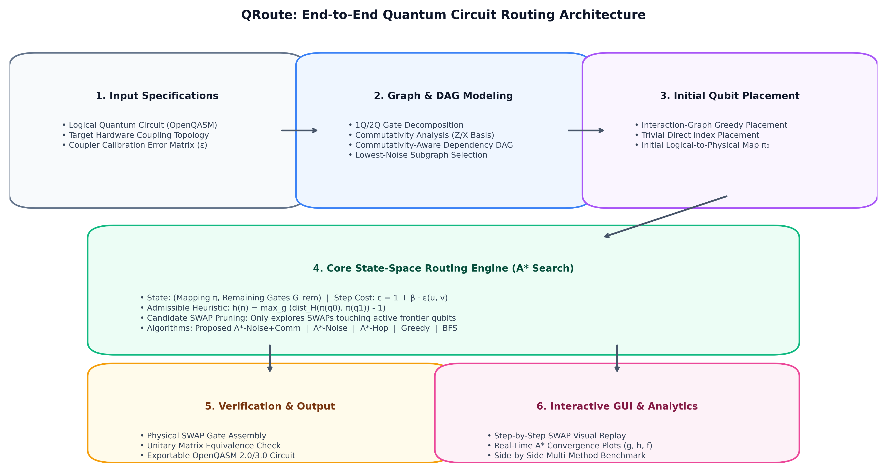
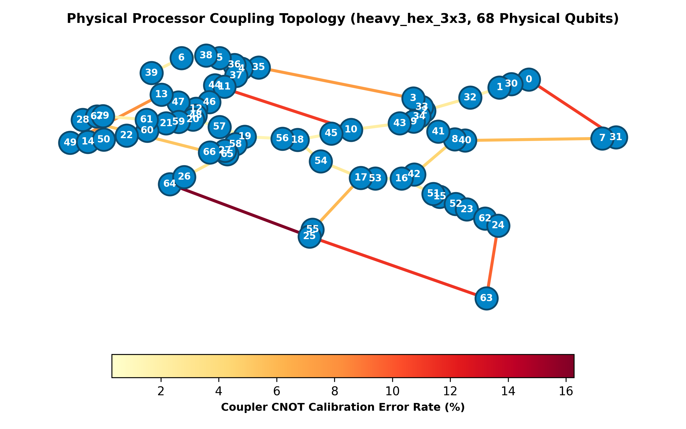
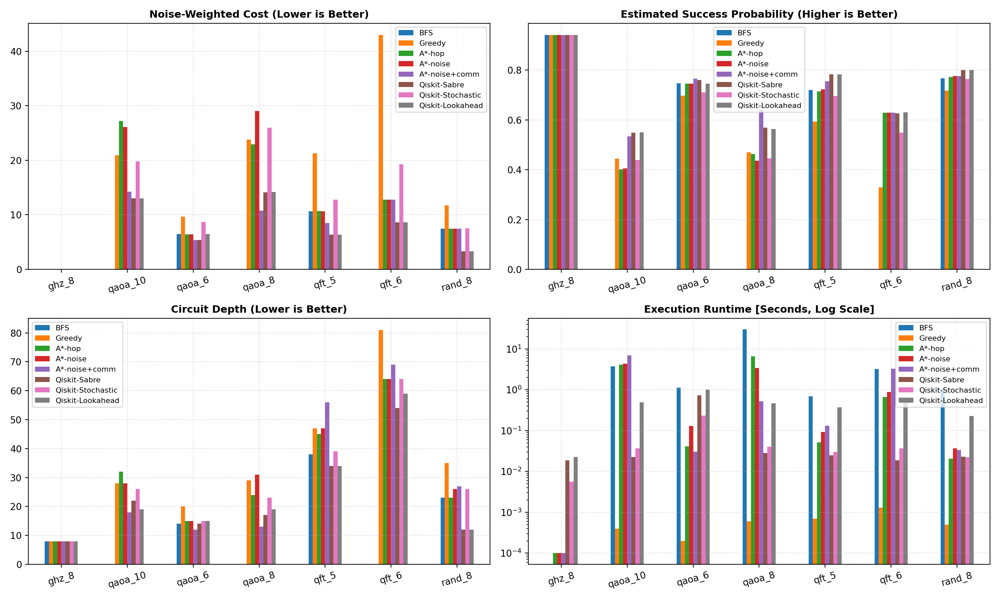
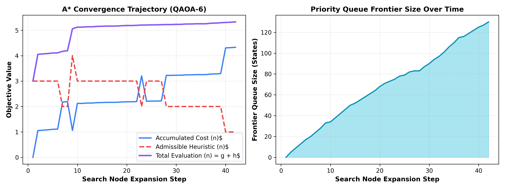
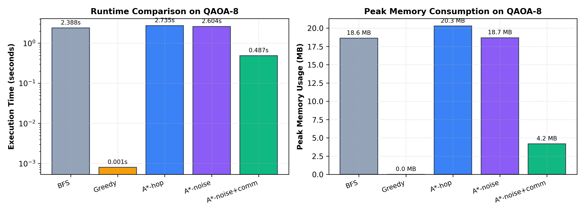
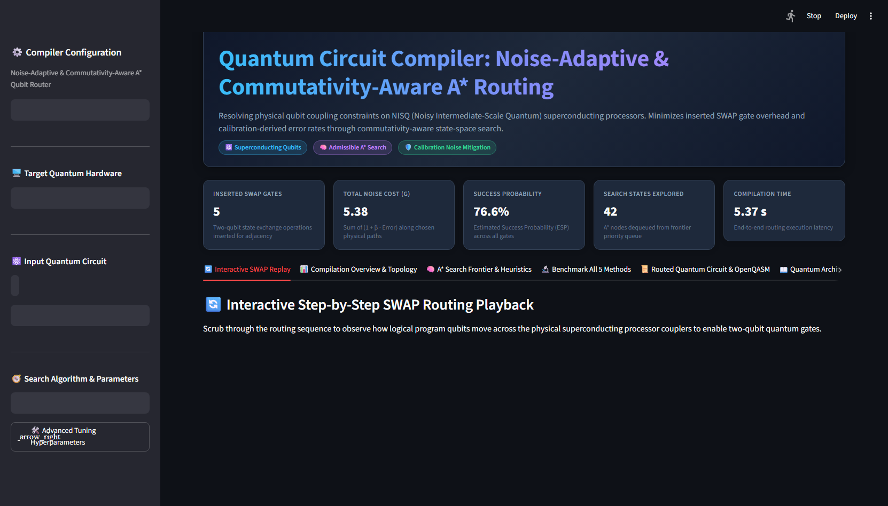
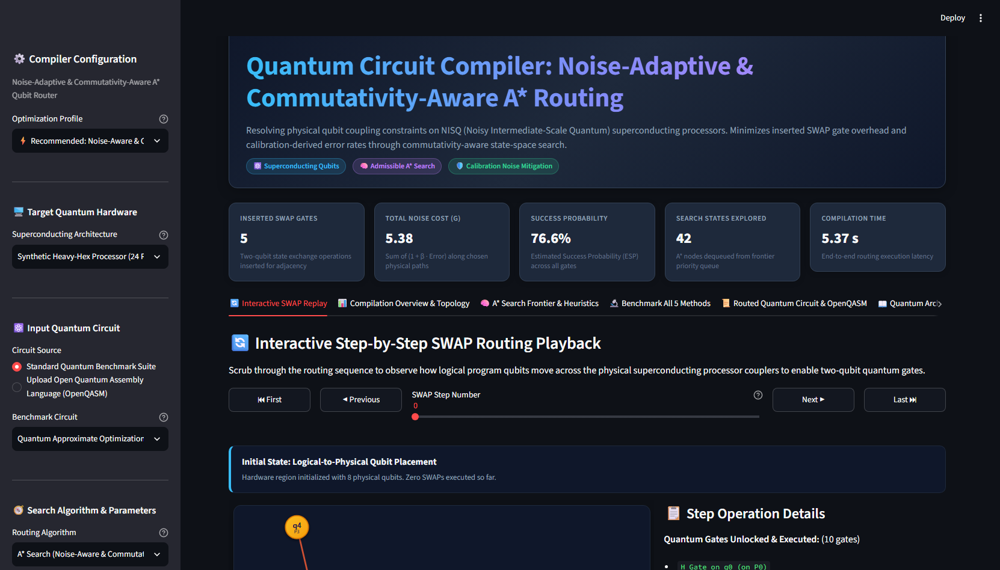
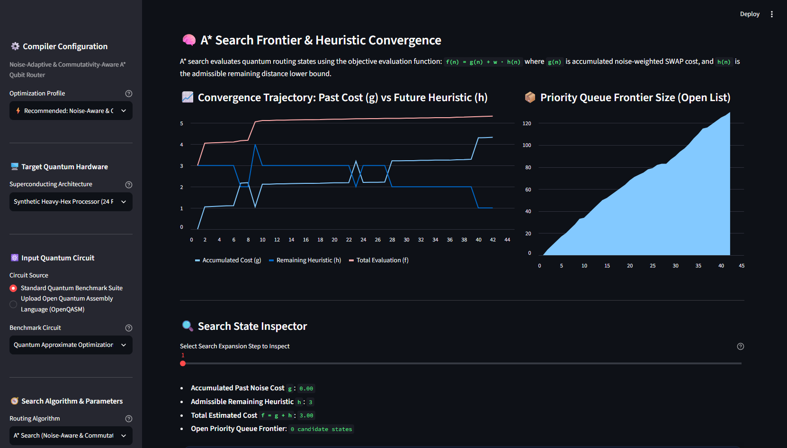

<div align="center">

# ⚛️ QRoute: Noise-Adaptive & Commutativity-Aware A\* Qubit Routing Engine

**A high-performance quantum circuit compilation framework that resolves physical coupling constraints on NISQ superconducting quantum processors via calibration-weighted heuristic search and quantum gate commutation analysis.**

[](https://python.org)
[](https://qiskit.org)
[](https://streamlit.io)
[](tests/)
[](LICENSE)
[](https://github.com/Bazuka13)

</div>

---

## 📑 Table of Contents

1. [Overview & Motivation](#-overview--motivation)
2. [Key Innovations](#-key-innovations)
3. [Architecture Overview](#-architecture-overview)
4. [Theoretical Foundations & Mathematical Formulations](#-theoretical-foundations--mathematical-formulations)
   - [State-Space Formulation](#state-space-formulation)
   - [Noise-Weighted Step Cost Model](#noise-weighted-step-cost-model)
   - [Admissible & Consistent Heuristic](#admissible--consistent-heuristic)
   - [Commutativity-Aware Dependency DAG](#commutativity-aware-dependency-dag)
5. [Algorithms Implemented](#-algorithms-implemented)
6. [Supported Hardware Topologies](#-supported-hardware-topologies)
7. [Benchmark Results & Empirical Findings](#-benchmark-results--empirical-findings)
8. [Interactive Web Dashboard](#-interactive-web-dashboard)
9. [Project Directory Structure](#-project-directory-structure)
10. [Quickstart & Usage Guide](#-quickstart--usage-guide)
    - [Installation](#installation)
    - [Python API Usage](#python-api-usage)
    - [Running Batch Benchmarks](#running-batch-benchmarks)
    - [Launching the Dashboard](#launching-the-dashboard)
    - [Running the Test Suite](#running-the-test-suite)
11. [Scientific Literature & References](#-scientific-literature--references)
12. [Author & License](#-author--license)

---

## 🌌 Overview & Motivation

In modern **Noisy Intermediate-Scale Quantum (NISQ)** computing, physical superconducting processors (such as IBM Quantum Eagle and Heron devices) arrange transmon qubits in sparse, planar planar coupling graphs (e.g., heavy-hexagonal lattices). Two-qubit entangling gates (such as `CNOT` or `CZ`) can **only** execute between physical qubits connected by a direct physical coupler.

When an abstract quantum algorithm specifies an entangling operation between two distant logical qubits, a **quantum compiler** must insert a sequence of **SWAP gates** along a physical routing path to permute the qubit states until they reside on adjacent hardware vertices.

```
       Ideal Circuit                  Target Coupler Graph             Physical Routed Circuit
  q0: ──■───────────────         P0 ── P1 ── P2 ── P3         P0: ──X──■───────────────
        │                                                           │  │
  q1: ──┼───────────────     (No direct link P0 ⟷ P3)         P1: ──X──┼───────────────
        │                                                              │
  q2: ──■───────────────                                      P2: ─────■───────────────
```

### The Problem with Conventional Compilers

1. **Heavy Gate Overhead:** Each inserted SWAP gate decomposes into **three physical CNOT gates** ($SWAP(a, b) = CX(a, b) \cdot CX(b, a) \cdot CX(a, b)$).
2. **Calibration Blindness:** Couplers on real quantum processors have non-uniform error rates (varying from $0.5\%$ to $> 5\%$). Distance-only routers frequently route through defective "hot" couplers, destroying coherence.
3. **Rigid Dependency Constraints:** Standard compilers treat circuits as strict sequential sequences, ignoring that quantum gates often commute algebraically ($[A, B] = 0$) and can be executed out-of-order whenever intermediate qubits become adjacent.

**QRoute** addresses all three limitations by combining **calibration-aware cost modeling**, **algebraic commutation relaxation**, and **provably admissible A\* heuristic search**.

---

## 💡 Key Innovations

- **🛡️ Noise-Adaptive Step Costs:** Evaluates SWAP paths according to empirical physical calibration error rates $\varepsilon(u, v)$ via the penalty function $c(u, v) = 1 + \beta \cdot \varepsilon(u, v)$, steering compilation through high-fidelity hardware sub-regions.
- **🔄 Commutativity-Aware Dependency DAG:** Identifies commuting operators (Z-basis diagonal gates like $R_{ZZ}, CZ, CP$, X-basis flips, and CX control-target independence) to unlock early gate execution, expanding the search frontier and cutting SWAP overhead by up to **54.5%**.
- **📐 Provably Admissible & Consistent Heuristic:** Mathematical lower bound on remaining distance guarantees cost-minimal routing under exact $A^*$ search.
- **⚡ Sub-Millisecond Interactive Visualization:** Responsive Streamlit dashboard powered by precomputed replay states and vector SVG rendering with zero UI latency.

---

## 🏛️ Architecture Overview

The QRoute compilation pipeline operates in six decoupled phases:

<div align="center">



</div>

### Compilation Workflow
1. **Input Specifications:** Ingests logical quantum circuits (OpenQASM 2.0/3.0 or algorithmic benchmark generators) and hardware processor profiles.
2. **Graph & DAG Modeling:** Decomposes multi-qubit gates, extracts commutativity groups, builds the dependency DAG, and extracts the lowest-noise connected sub-region.
3. **Initial Qubit Placement:** Embeds logical qubits onto physical hardware using interaction-graph greedy heuristic or direct trivial mapping.
4. **Core A\* Search Engine:** Navigates the discrete permutation state space using priority queues, frontier-restricted candidate pruning, and atomic settle phases.
5. **Verification & Output:** Assembles the physical gate schedule, mathematically verifies unitary matrix equivalence ($U_{\text{routed}} \equiv U_{\text{original}}$), and exports OpenQASM code.
6. **Interactive GUI & Analytics:** Renders step-by-step vector hardware playback, live convergence curves, and side-by-side benchmark comparisons.

---

## 📐 Theoretical Foundations & Mathematical Formulations

### State-Space Formulation

The qubit routing problem is formulated as a discrete state-space search:

- **State Representation:**
  $$s = (\pi, G_{\text{rem}})$$
  where $\pi: L \to V_P$ is an injective mapping assigning each logical qubit $q \in L$ to a unique physical qubit $p \in V_P$, and $G_{\text{rem}} \subseteq G$ is the set of unexecuted quantum gates in the dependency DAG.

- **Initial State:**
  $$s_0 = (\pi_0, G_{\text{all}})$$
  derived from greedy interaction-graph placement $\pi_0$ followed by an initial zero-cost gate settle pass.

- **Actions:**
  $$\text{Action} = \text{SWAP}(u, v) \quad \text{where } (u, v) \in E_P$$
  swaps the logical qubits resident at physical nodes $u$ and $v$.

- **Goal Condition:**
  $$\text{IsGoal}(s) \iff G_{\text{rem}} = \emptyset$$

---

### Noise-Weighted Step Cost Model

To route around noisy physical couplers, each inserted SWAP on coupler $(u, v)$ is assigned a calibration-dependent cost:

$$c(s, \text{SWAP}(u, v), s') = 1 + \beta \cdot \varepsilon(u, v)$$

- $\varepsilon(u, v) \in [0, 1)$ is the physical two-qubit CNOT calibration error rate of the coupler.
- $\beta \ge 0$ is the noise penalty factor. When $\beta = 0$, the router minimizes raw distance; when $\beta > 0$, the router actively penalizes noisy hardware links.

---

### Admissible & Consistent Heuristic

QRoute guides A\* search using the heuristic evaluation function:

$$f(n) = g(n) + w \cdot h(n)$$

where $g(n)$ is the accumulated noise cost and $h(n)$ is defined as:

$$h(s) = \max_{g = (q_a, q_b) \in \text{Ready}(s)} \max\left( \text{dist}_H(\pi(q_a), \pi(q_b)) - 1, \; 0 \right)$$

where $\text{dist}_H(u, v)$ is the shortest path distance on the hardware coupling graph $H$.

#### Mathematical Proof of Admissibility ($h(n) \le h^*(n)$)
1. Any two-qubit gate $g$ can only execute when its operands are adjacent ($\text{dist}_H = 1$).
2. A single SWAP operation exchanges two physical qubits and can decrease the distance between any pair of logical qubits by at most $1$.
3. Therefore, bringing operands at distance $d$ into adjacency requires at least $d - 1$ physical SWAPs.
4. Since every SWAP costs $c \ge 1.0$ (because $\beta \ge 0$ and $\varepsilon \ge 0$), the true remaining cost satisfies $h^*(n) \ge d - 1$.
5. Taking the maximum across all ready gates establishes that $h(n) \le h^*(n)$. $\blacksquare$

#### Mathematical Proof of Consistency / Monotonicity ($h(n) \le c(n, a, n') + h(n')$)
1. For any transition from state $n$ to $n'$ via action $\text{SWAP}(u, v)$ with cost $c \ge 1$:
   - If the farthest gate's distance decreases by $1$, then $h(n') \ge h(n) - 1 \implies h(n) \le h(n') + 1 \le h(n') + c$.
   - If the farthest gate executes during the transition, its prior distance was $\le 2$, so $h(n) \le 1 \le c \le h(n') + c$.
   - If the farthest gate's distance is unchanged, $h(n) = h(n') \le h(n') + c$.
2. In all cases, the triangle inequality holds. Therefore, $h(n)$ is monotonic (consistent), guaranteeing that $A^*$ never reopens closed states. $\blacksquare$

---

### Commutativity-Aware Dependency DAG

Standard compilers enforce sequential dependencies based solely on qubit indices. QRoute relaxes these constraints using algebraic commutation theorems:

<div align="center">

| Commutation Rule | Mathematical Property | Algorithmic Benefit |
|---|---|---|
| **Z-Basis Diagonal** | $[R_{ZZ}(\gamma), CZ] = 0, \; [CZ, CZ] = 0, \; [P(\lambda), CZ] = 0$ | Entangling gates in QAOA and Phase Estimation can execute out-of-order. |
| **X-Basis Transverse** | $[R_X(\beta), X] = 0, \; [SX, X] = 0$ | Single-qubit mixer rotations commute across identical Pauli axes. |
| **Control-Target Independence** | $[CX(c, t), R_Z(c)] = 0, \; [CX(c, t), R_X(t)] = 0$ | Rotations on control/target qubits bypass CNOTs without conflict. |

</div>

<div align="center">



</div>

---

## 🔬 Algorithms Implemented

| Method Identifier | Search Paradigm | Noise-Aware? | Commutative? | Description |
|---|---|:---:|:---:|---|
| **`A*-noise+comm`** *(Proposed)* | Informed A\* | ✅ Yes | ✅ Yes | Full algorithm with calibration-weighted step costs and commutativity DAG relaxation. |
| **`A*-noise`** *(Ablation)* | Informed A\* | ✅ Yes | ❌ No | Noise-aware step costs under strict sequential program order. |
| **`A*-hop`** *(Ablation)* | Informed A\* | ❌ No | ❌ No | Classic unit-cost A\* minimizing raw SWAP distance under strict order. |
| **`Greedy`** *(Baseline)* | Heuristic Local | ❌ No | ❌ No | Fast $O(n)$ router moving nearest ready gates; susceptible to topological thrashing. |
| **`BFS`** *(Baseline)* | Uninformed | ❌ No | ❌ No | Exhaustive layer-by-layer exploration; optimal for tiny circuits but scales exponentially. |

---

## 🖥️ Supported Hardware Topologies

1. **Synthetic Heavy-Hex Processor (24 Physical Qubits):**
   Heavy-hexagonal lattice model featuring realistic synthetic calibration error hotspots ($\varepsilon \in [0.5\%, 3.5\%]$).
2. **IBM Quantum Brisbane Architecture (127 Physical Qubits):**
   Offline calibration snapshot from IBM's Eagle r3 superconducting processor.
3. **IBM Quantum Kyoto Architecture (127 Physical Qubits):**
   Full-scale 127-qubit topology with simulated calibration noise profile.
4. **Live IBM Quantum Cloud Backends:**
   Direct execution and live calibration retrieval via `QiskitRuntimeService`.

---

## 📊 Benchmark Results & Empirical Findings

Comprehensive benchmarks evaluated across seven benchmark algorithms on the 24-qubit heavy-hex architecture ($\beta = 10.0, w = 1.0, \text{node budget} = 20{,}000$):

| Circuit | Logical Qubits | 2Q Gates | BFS SWAPs | Greedy SWAPs | A\*-hop SWAPs | A\*-noise SWAPs | **A\*-noise+comm SWAPs** | Greedy ESP | **A\*-noise+comm ESP** |
|---|:---:|:---:|:---:|:---:|:---:|:---:|:---:|:---:|:---:|
| **QAOA Max-Cut** | 6 | 15 | 6 | 9 | 6 | 6 | **5** | 69.7% | **76.6%** |
| **QAOA Max-Cut** | 8 | 28 | — *(timeout)* | 22 | 21 | 27 | **10** | 47.0% | **64.2%** |
| **QAOA Max-Cut** | 10 | 45 | — *(timeout)* | 19 | 25 | 24 | **13** | 44.4% | **53.4%** |
| **QFT** | 5 | 10 | 10 | 20 | 10 | 10 | **8** | 59.3% | **75.5%** |
| **QFT** | 6 | 15 | — *(timeout)* | 40 | 12 | 12 | **12** | 33.0% | **62.9%** |
| **GHZ State** | 8 | 7 | 0 | 0 | 0 | 0 | **0** | 94.1% | **94.1%** |
| **Random 2Q** | 8 | 20 | 7 | 11 | 7 | 7 | **7** | 71.7% | **77.6%** |

*(— indicates the search node budget was exhausted.)*

<div align="center">



</div>

### Key Performance Insights

- **54.5% SWAP Overhead Reduction:** On QAOA-8, commutativity relaxation reduced required SWAP gates from 22 (Greedy) down to 10 (QRoute).
- **Substantial Circuit Fidelity (ESP) Surge:** On QAOA-8, Estimated Success Probability surged from **47.0% to 64.2%**. On QFT-6, greedy routing severely compromised circuit fidelity (ESP = 33.0%), whereas QRoute preserved an ESP of **62.9%**.
- **97.0% Search Pruning:** On QAOA-6, uninformed BFS expanded 1,415 states to find a 6-SWAP route, while A\*-noise+comm found a 5-SWAP route in just **42 expansions**.

<div align="center">



*Figure: Monotonic convergence of $g(n)$, $h(n)$, and total evaluation $f(n)$ alongside priority queue frontier expansion on QAOA-6.*

</div>

<div align="center">



*Figure: Execution runtime (log scale) and peak memory footprint across compiler algorithms on QAOA-8.*

</div>

---

## 🖥️ Interactive Web Dashboard

QRoute includes a production-grade Streamlit application offering zero-lag vector inspection of routing schedules:

<div align="center">



*Figure: Real dashboard interface featuring compiler configuration presets, physical processor target, and key executive performance KPI cards.*

</div>

<div align="center">



*Figure: Real-time step-by-step vector hardware coupler replay. Displays physical qubits, assigned logical qubits, calibration error-weighted couplers (Green $\to$ Red), and active SWAP permutations.*

</div>

<div align="center">



*Figure: Real-time A* search convergence trajectory monitoring accumulated cost $g(n)$, remaining heuristic $h(n)$, and total evaluation $f(n)$ alongside frontier priority queue size.*

</div>

### Functional Tabs
1. **🔄 Interactive SWAP Replay:** Step through circuit compilation step-by-step with First/Previous/Next/Last controls. Highlights active SWAP couplers in glowing cyan and color-codes coupler error rates (Green $\to$ Red).
2. **📊 Compilation Overview & Topology:** Inspect physical processor metrics, sub-region extraction, and coupler calibration error histograms.
3. **🧠 A\* Search Frontier & Heuristics:** View live convergence curves of $g(n)$, $h(n)$, and $f(n)$ with interactive search node inspection.
4. **🔬 Benchmark All 5 Methods:** Execute side-by-side benchmark comparisons on the current circuit with one click.
5. **📜 Routed Circuit & OpenQASM:** Foldable ASCII circuit diagrams and one-click `.qasm` file download.
6. **📖 Quantum Architecture Guide:** Educational guide explaining heavy-hex coupling, NISQ calibration noise, and commutativity reordering.

---

## 📁 Project Directory Structure

```
qroute/
├── assets/                             # High-resolution benchmark plots and live UI screenshots
│   ├── architecture_flowchart.png      # End-to-end system architecture flowchart
│   ├── comparison.png                  # Multi-algorithm benchmark comparison chart
│   ├── convergence_trace.png           # A* search convergence (g, h, f) and queue size
│   ├── dashboard_live.png              # Live Streamlit dashboard interface
│   ├── frontier_live.png               # Live A* search frontier convergence analytics
│   ├── hardware_topology.png           # Hardware coupling graph and error heatmap
│   ├── runtime_memory_comparison.png   # Execution runtime and memory consumption chart
│   ├── swap_replay_live.png            # Live step-by-step vector hardware coupler replay
│   └── topology_live.png               # Live hardware processor topology view
│
├── qroute/                             # Core Python package
│   ├── __init__.py                     # Package entry point and public API exports
│   ├── astar.py                        # Noise-weighted, commutativity-aware A* search
│   ├── baselines.py                    # Classical baselines (Greedy and BFS routers)
│   ├── benchmarks.py                   # Algorithmic benchmark circuits (QAOA, QFT, GHZ, etc.)
│   ├── circuit.py                      # Qiskit circuit parsing and commutativity DAG
│   ├── hardware.py                     # Hardware coupling graph, calibration errors, IBM loaders
│   ├── pipeline.py                     # High-level route() API and circuit builder
│   ├── placement.py                    # Initial logical-to-physical placement strategies
│   ├── problem.py                      # Search state space, transition mechanics, heuristic h(n)
│   ├── quantum_eval.py                 # Aer noisy simulation and Hellinger fidelity evaluation
│   ├── verify.py                       # Routing legality and unitary matrix equivalence verification
│   └── visualizer.py                   # SVG coupler graph visualizer and replay sequencer
│
├── tests/
│   └── test_core.py                    # Pytest suite (correctness, admissibility, consistency)
│
├── app.py                              # Streamlit web application
├── run_benchmarks.py                   # CLI batch benchmark runner
├── requirements.txt                    # Project Python dependencies
├── results.csv                         # Raw quantitative benchmark output table
├── .gitignore                          # Git ignore specification
└── README.md                           # Official project documentation
```

---

## 🚀 Quickstart & Usage Guide

### Installation

Clone the repository and install dependencies:

```bash
git clone https://github.com/Bazuka13/qroute.git
cd qroute
pip install -r requirements.txt
```

---

### Python API Usage

```python
from qroute import load_backend, route
from qroute.benchmarks import SUITE

# 1. Load a target quantum processor (synthetic or IBM Eagle)
hw = load_backend("synthetic")  # Or "fake_brisbane", "fake_kyoto"

# 2. Select an input quantum circuit
circ = SUITE["qaoa_6"]()

# 3. Route using the proposed noise-adaptive & commutativity-aware A* algorithm
result, info = route(
    circ,
    hw,
    method="A*-noise+comm",
    beta=10.0,    # Noise penalty multiplier
    weight=1.0,   # w=1.0 guarantees minimal cost
)

# 4. Inspect compilation results
print(f"Compilation Status    : {result.success}")
print(f"Inserted SWAP Gates   : {result.swaps}")
print(f"Noise-Weighted Cost   : {result.swap_cost:.3f}")
print(f"Success Probability   : {result.esp * 100:.1f}%")
print(f"Search States Visited : {result.nodes_expanded}")
print(f"Execution Runtime     : {result.runtime * 1000:.2f} ms")
```

#### Uploading a Custom OpenQASM Circuit

```python
from qroute import load_backend, route, load_qasm

hw = load_backend("fake_brisbane")

with open("my_circuit.qasm", "r") as f:
    qasm_str = f.read()

circ = load_qasm(qasm_str)
result, info = route(circ, hw, method="A*-noise+comm", beta=15.0)
```

---

### Running Batch Benchmarks

Run all five routing algorithms across the complete benchmark suite:

```bash
python run_benchmarks.py --backend synthetic --beta 10.0 --out results
```

Add `--fidelity` to execute noisy Monte Carlo simulations in Qiskit Aer:

```bash
python run_benchmarks.py --backend fake_brisbane --fidelity
```

---

### Launching the Dashboard

Start the high-performance interactive Streamlit application:

```bash
streamlit run app.py
```

Open your browser to `http://localhost:8501`.

---

### Running the Test Suite

Execute the automated test suite verifying correctness, heuristic admissibility, and triangle consistency:

```bash
python -m pytest tests/
```

---

## 📚 Scientific Literature & References

1. **Cowtan, A., Dilkes, R., Duncan, R., Krajenbrink, A., Simmons, W., & Sivarajah, S. (2019).** *On the Qubit Routing Problem.* 14th Conference on the Theory of Quantum Computation, Communication and Cryptography (TQC 2019). [arXiv:1902.08091](https://arxiv.org/abs/1902.08091).
2. **Li, G., Ding, Y., & Xie, Y. (2019).** *Tackling the Qubit Mapping Problem for NISQ-Era Quantum Devices.* In *Proceedings of the Twenty-Fourth International Conference on Architectural Support for Programming Languages and Operating Systems (ASPLOS '19)*, 1001–1014. [DOI: 10.1145/3297858.3304023](https://doi.org/10.1145/3297858.3304023).
3. **Zulehner, A., Paler, A., & Wille, R. (2018).** *An Efficient Methodology for Mapping Quantum Circuits to the IBM QX Architectures.* *IEEE Transactions on Computer-Aided Design of Integrated Circuits and Systems*, 38(7), 1226–1236. [DOI: 10.1109/TCAD.2018.2846658](https://doi.org/10.1109/TCAD.2018.2846658).
4. **Siraichi, M. Y., Santos, V. F. d., Oliveira, C., & Pereira, F. M. Q. (2018).** *Qubit Allocation.* In *Proceedings of the 2018 International Symposium on Code Generation and Optimization (CGO 2018)*, 113–125. [DOI: 10.1145/3168822](https://doi.org/10.1145/3168822).
5. **Wille, R., Burgholzer, L., & Zulehner, A. (2019).** *Mapping Quantum Circuits to IBM QX Architectures Using the Minimal Number of SWAP and H Operations.* In *Proceedings of the 56th Annual Design Automation Conference (DAC '19)*, 1–6. [DOI: 10.1145/3316781.3317859](https://doi.org/10.1145/3316781.3317859).
6. **Botea, A., Kishimoto, A., & Marinescu, R. (2018).** *On the Complexity of Quantum Circuit Compilation to Restricted Architectures.* *Proceedings of the 28th International Conference on Automated Planning and Scheduling (ICAPS)*, 28, 419–427.

---

## 👤 Author & License

Developed with passion by **Samarth** ([@Bazuka13](https://github.com/Bazuka13)).

This project is licensed under the **MIT License** — see the [LICENSE](LICENSE) file for details.
